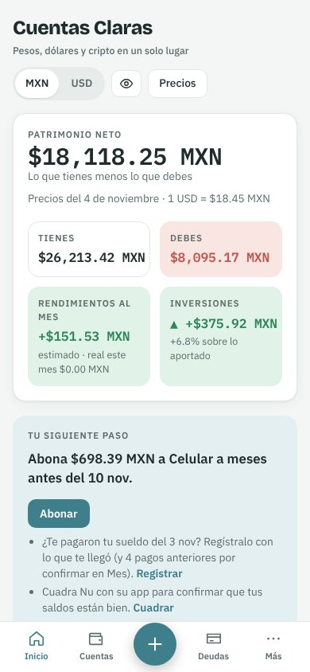

  

<h1 align="center">Cuentas Claras</h1>

<strong>Pesos, dólares y cripto en un solo lugar.</strong> 
Tus cuentas, inversiones, deudas y gastos del mes, claros. Para Android y Windows.

  <a href="https://github.com/jeanskull/CuentasClaras-release/releases/download/v1.17.0-ensayo/CuentasClaras_1.17.0_android.apk"><strong>Descargar para Android</strong></a>
  &nbsp;·&nbsp;
  <a href="https://github.com/jeanskull/CuentasClaras-release/releases/download/v1.17.0-ensayo/Cuentas.Claras_1.17.0_x64-setup.exe"><strong>Descargar para Windows</strong></a>
  &nbsp;·&nbsp;
  <a href="https://github.com/jeanskull/CuentasClaras-release/releases">Todas las versiones</a>

Versión de prueba 1.17.0 · Android 7 o superior · Windows 10 y 11 (64 bits)

  

## Qué puedes hacer

- **Cuentas por app** (banco, exchange, casa de bolsa o billetera) con rendimientos, topes y metas de ahorro.
- **Inversiones y bots** con capital aportado, ciclos, cierre y ganancia realizada.
- **Deudas** con intereses, pagos a meses, próximos pagos y un plan para liquidarlas.
- **Mes**: ingresos, gastos por categoría con límites, gastos fijos y sueldo.
- **Precios al día**: el dólar y tus criptos se actualizan solos.
- **Niveles y rangos compartidos con Hito:** subes por hábitos (registrar, pagar a tiempo, cumplir metas), nunca por cuánto dinero tienes. Cada rango nuevo se revela con una celebración.
- **Funciona sin conexión.** Tus datos se guardan en tu dispositivo y la app hace un respaldo automático cada semana.

  

## Instalar en Android

1. Abre en tu celular el enlace **Descargar para Android** y descarga el archivo `.apk`.
2. Ábrelo desde las notificaciones o desde la carpeta Descargas.
3. Si Android pide permiso para *instalar apps de fuentes desconocidas*, actívalo para tu navegador o para «Archivos» y vuelve atrás.
4. Si aparece Google Play Protect, elige **Más detalles → Instalar de todas formas**. Aparece porque la app todavía no se distribuye por Play Store.
5. Toca **Instalar** y abre Cuentas Claras.

## Instalar en Windows

1. Descarga el instalador con el enlace **Descargar para Windows**.
2. Ábrelo. Si Windows muestra *«Windows protegió tu PC»*, elige **Más información → Ejecutar de todas formas**. El aviso sale porque el instalador aún no tiene un certificado comercial de editor.
3. Sigue los pasos del instalador y abre Cuentas Claras desde el menú Inicio.

## Actualizaciones

Cuentas Claras te avisa dentro de la app cuando hay una versión nueva, en **Ajustes → Acerca de**. La descarga se verifica antes de instalarse y tus datos se conservan.

## Tus datos

- Todo se guarda **solo en tu dispositivo**. No necesitas cuenta.
- Cada semana la app guarda una copia de seguridad automática: en Windows en *Documentos\Cuentas Claras\Respaldos*, y en Android 10 o superior en *Descargas/Cuentas Claras*. También puedes descargar un respaldo cuando quieras desde Ajustes.
- Para consultar precios, la app solo descarga el tipo de cambio y los precios públicos de criptos; no envía nada tuyo.

## Novedades de la 1.17.0

**Mejorado**

- Al actualizar, «Lo nuevo» se abre como hoja desde abajo, igual que en Hito y Reliquia: estrella, tu versión, lo que cambió y el botón «Entendido». Antes solo salía una franja que decía «se actualizó» con un enlace a Ajustes.
- Ajustes se ven como en Hito y Reliquia: grupos con título (Tu cuenta, La app, Tus datos y Cuentas Claras), una fila con icono y descripción para cada apartado, y en el celular cada pantalla interna tiene su botón para volver con su nombre arriba.
- El tema se elige con cuatro botones: Oscuro, Claro, Cálido y Sistema.
- Novedades tiene su propia fila en Ajustes (antes estaba al final de «Acerca de»), con la etiqueta «Nuevo» mientras no la abras. El historial va por mes y año: el mes actual abierto y los anteriores plegados con cuántas versiones traen. Si un mes trae muchas versiones, se separa por semanas, y cada versión muestra un resumen («4 nuevos · 1 mejora») que se abre al tocarla.

## Novedades de la 1.16.0

**Agregado**

- Saludo en el Resumen: «Buenos días», «Buenas tardes» o «Buenas noches» según la hora, con tu nombre si lo pones en Ajustes → Apariencia → «¿Cómo te llamo?».
- Frase del día arriba del Resumen: cuánto te queda este mes y cuánto sale por día, o qué tan cerca vas de una meta o de terminar una deuda. Con deudas te da ánimo (en verde). Y si las cosas se ponen feas (dos meses o más en rojo, pérdidas grandes en el mes, varios días apostando o deudas que suben) te regaña con cariño (en rojo) para que te pongas las pilas. Hay varias frases para cada situación y cambian cada día, para que no sea siempre la misma.
- Tema «Cálido» (Ajustes → Apariencia → Tema): oscuro con ámbar y coral.
- Festejo al cerrar el mes con ahorro: la primera vez que abres la app en un mes nuevo, si el anterior te dejó dinero libre.

**Mejorado**

- Los festejos (deuda liquidada, meta cumplida) ahora salen en una tarjeta con mensaje y el confeti usa los colores de tu tema.

Desde la app puedes ver el historial completo en **Ajustes → Acerca de → Registro de cambios**.

---

Creado por <strong>JeanSkull</strong> · Desarrollado con la ayuda de Claude

