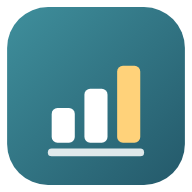
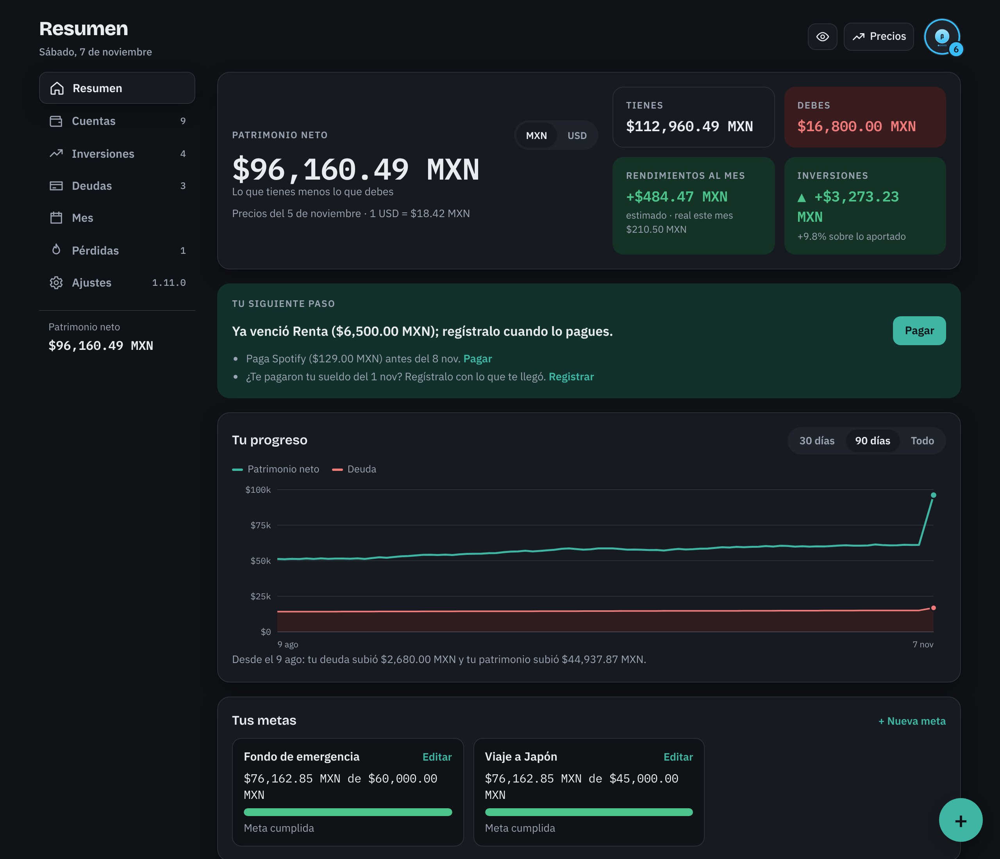
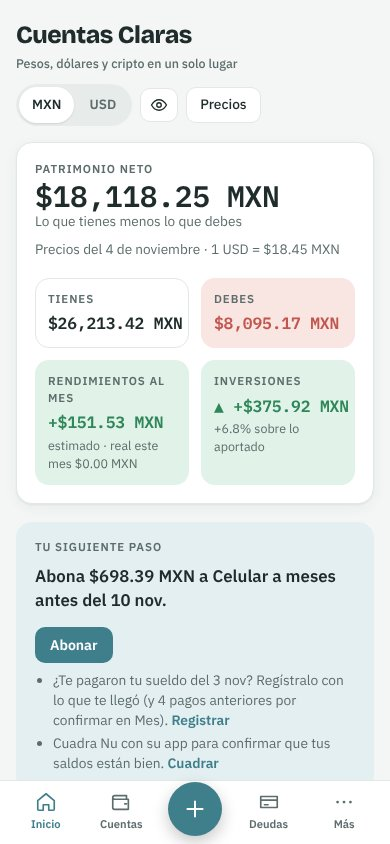

  

<h1 align="center">Cuentas Claras</h1>

<strong>Pesos, dólares y cripto en un solo lugar.</strong> 
Tus cuentas, inversiones, deudas y gastos del mes, claros. Para Android y Windows.

  <a href="https://github.com/jeanskull/CuentasClaras-release/releases/download/v1.11.0-ensayo/CuentasClaras_1.11.0_android.apk"><strong>Descargar para Android</strong></a>
  &nbsp;·&nbsp;
  <a href="https://github.com/jeanskull/CuentasClaras-release/releases/download/v1.11.0-ensayo/Cuentas.Claras_1.11.0_x64-setup.exe"><strong>Descargar para Windows</strong></a>
  &nbsp;·&nbsp;
  <a href="https://github.com/jeanskull/CuentasClaras-release/releases">Todas las versiones</a>

Versión de prueba 1.11.0 · Android 7 o superior · Windows 10 y 11 (64 bits)

  

## Qué puedes hacer

- **Cuentas por app** (banco, exchange, casa de bolsa o billetera) con rendimientos, topes y metas de ahorro.
- **Inversiones y bots** con capital aportado, ciclos, cierre y ganancia realizada.
- **Deudas** con intereses, pagos a meses, próximos pagos y un plan para liquidarlas.
- **Mes**: ingresos, gastos por categoría con límites, gastos fijos y sueldo.
- **Precios al día**: el dólar y tus criptos se actualizan solos.
- **Funciona sin conexión.** Tus datos se guardan en tu dispositivo y la app hace un respaldo automático cada semana.

  

## Instalar en Android

1. Abre en tu celular el enlace **Descargar para Android** y descarga el archivo `.apk`.
2. Ábrelo desde las notificaciones o desde la carpeta Descargas.
3. Si Android pide permiso para *instalar apps de fuentes desconocidas*, actívalo para tu navegador o para «Archivos» y vuelve atrás.
4. Si aparece Google Play Protect, elige **Más detalles → Instalar de todas formas**. Aparece porque la app todavía no se distribuye por Play Store.
5. Toca **Instalar** y abre Cuentas Claras.

## Instalar en Windows

1. Descarga el instalador con el enlace **Descargar para Windows**.
2. Ábrelo. Si Windows muestra *«Windows protegió tu PC»*, elige **Más información → Ejecutar de todas formas**. El aviso sale porque el instalador aún no tiene un certificado comercial de editor.
3. Sigue los pasos del instalador y abre Cuentas Claras desde el menú Inicio.

## Actualizaciones

Cuentas Claras te avisa dentro de la app cuando hay una versión nueva, en **Ajustes → Acerca de**. La descarga se verifica antes de instalarse y tus datos se conservan.

## Tus datos

- Todo se guarda **solo en tu dispositivo**. No necesitas cuenta.
- Cada semana la app guarda una copia de seguridad automática: en Windows en *Documentos\Cuentas Claras\Respaldos*, y en Android 10 o superior en *Descargas/Cuentas Claras*. También puedes descargar un respaldo cuando quieras desde Ajustes.
- Para consultar precios, la app solo descarga el tipo de cambio y los precios públicos de criptos; no envía nada tuyo.

## Novedades de la 1.11.0

**Agregado**

- Familia JeanSkull: hojas, menús, selector, avisos y confirmaciones con el mismo diseño que Hito.
- «Más» y el menú «⋯» de cada cuenta se abren como hojas desde abajo: nunca se salen de la pantalla, tapan por completo lo de atrás y se cierran deslizando hacia abajo o tocando fuera.
- Selector propio para monedas, cuentas y categorías (con buscador cuando hay muchas opciones) en lugar de la lista del sistema.
- Exchanges: «+ Apartado» ofrece Fondos, Trading y Earn de un toque (o un nombre propio), y cada apartado muestra «+ Moneda» aunque tenga una sola.
- Tu perfil: tarjeta con tu avatar, tu marco, tu nombre y tu rol. El rol se comparte con Hito.
- Insignias vivas: brillo, anillo que gira, aura y destellos según tu rango. Al subir de nivel hay ráfaga de partículas, ondas y la barra se llena.

**Mejorado**

- Avisos de uno en uno, con «Deshacer» cuando aplica.
- Casillas y enlaces más fáciles de tocar en el celular; letra mínima de 12 px.
- Los logos de bancos eligen el color de letra que mejor se lee sobre su color.
- Windows: la ventana abre oscura desde el inicio (sin pantalla blanca), con barra de título y de desplazamiento oscuras.

**Corregido**

- El menú «⋯ Más» de una cuenta se salía por la izquierda cuando el botón bajaba a otra línea.
- En exchanges no se podía agregar una segunda moneda a un apartado.
- En el celular, los botones Guardar/Cancelar de los diálogos quedaban bajo la barra de gestos.

## Novedades de la 1.10.0

**Agregado**

- Nivel compartido de las JeanSkull Apps: un solo nivel, EXP y rango para Cuentas Claras y Hito. Con sesión iniciada se juntan solos; sin sesión ves tu nivel de esta app.
- EXP por hábitos, nunca por cuánto dinero tienes: registrar movimientos (hasta 6 al día), rachas de 7 días registrando, cuadrar un banco con su app, pagar deudas y gastos fijos antes de su fecha, terminar un mes dentro de tus límites y cumplir metas. No cuentan montos, ganancias ni casino.
- Insignias de rango con tema de software (Alpha, Beta, Release Candidate, Estable, Producción, Optimizado y LTS); cada escalón suma detalles.
- Pantalla «Subiste de nivel», más grande cuando llegas a un rango nuevo, con lo que desbloqueaste. Respeta el ajuste de animaciones.
- Tu perfil (botón con tu inicial o tu insignia, arriba a la derecha): nombre, nivel, siguiente rango y cuánto te falta, y pestañas para tu EXP por app, marcos y logros.
- Marcos para tu foto de perfil: cada rango nuevo desbloquea uno.
- Logros de Cuentas Claras (primer registro, rachas, cuentas cuadradas, pagos a tiempo, mes dentro del plan, meta cumplida) y de la familia de apps.

Desde la app puedes ver el historial completo en **Ajustes → Acerca de → Registro de cambios**.

---

Creado por <strong>JeanSkull</strong> · Desarrollado con la ayuda de Claude

